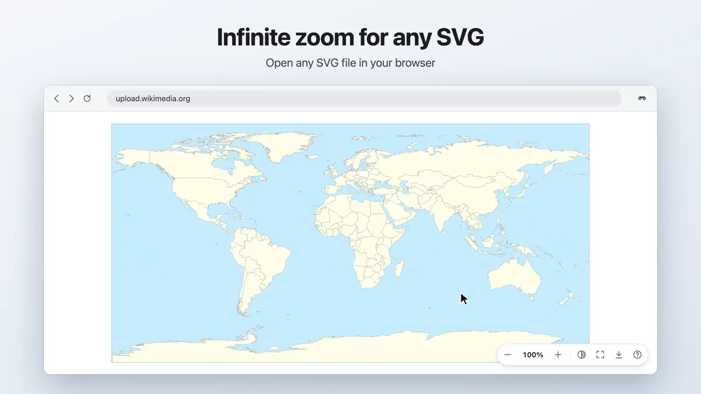

# SVG Navigator

<!-- bright-builds-rules-readme-badges:begin -->

<!-- Managed upstream by bright-builds-rules. If this badge block needs a fix, open an upstream PR or issue instead of editing the downstream managed block. Keep repo-local README content outside this managed badge block. -->

[](https://github.com/pRizz/SVG-Navigator---Chrome-Extension)
[](https://github.com/pRizz/SVG-Navigator---Chrome-Extension/actions/workflows/ci.yml)
[](./LICENSE.txt)
[](https://www.typescriptlang.org/)
[](https://github.com/bright-builds-llc/bright-builds-rules)
[](https://openlinks.us/)

<!-- bright-builds-rules-readme-badges:end -->

**Infinite zoom and panning for the SVG files you open in your browser.** Scroll into any
detail, drag to pan, and keep going: [SVG](https://www.w3.org/TR/SVG2/) is vector graphics, so it
stays sharp however far you zoom, and SVG Navigator has no zoom limit. Only the browser's numeric
precision stops it, many millions of times in.

<p align="center">
  <picture>
    <source media="(prefers-reduced-motion: reduce)" srcset="docs/images/readme-hero.png">
    
  </picture>
</p>

<p align="center">
  <a href="https://chromewebstore.google.com/detail/svg-navigator/pefngfjmidahdaahgehodmfodhhhofkl"><strong>Get it for Chrome</strong></a>
  &nbsp;·&nbsp;
  <a href="https://addons.mozilla.org/en-US/firefox/addon/svg-navigator/"><strong>Get it for Firefox</strong></a>
  &nbsp;·&nbsp;
  <a href="#install">Safari on macOS</a>
</p>

## Features

- **Infinite zoom** with the mouse wheel, trackpad, or pinch, centered on the pointer.
- **Smooth motion.** Let go of a quick pan and the view glides to a stop; button, key, and
  double-click steps ease into place (instantly with the OS's reduced-motion setting).
- **Zoom box.** Drag a box around exactly the area you want to see.
- **Minimap.** While part of the drawing is out of view, an overview outlines where you are;
  click it to jump, or drag the outline to pan.
- **Shareable views.** The address bar keeps the current view (`#svgView(viewBox(…))`), so
  reloading or sending the link opens that exact spot.
- **Export** the current view as a PNG (1×, 2×, or 4×, transparent background), download or copy
  the SVG as authored, or copy a link to the view.
- **Dark-mode friendly.** The background button cycles a transparency checkerboard, a dark
  background, and an inverted drawing (black lines turn white, colors keep their hue).
- **Selectable text**, when you turn it on: drag or double-click text to select and copy it,
  while dragging anywhere else still pans.
- **Works wherever SVGs are served**, including URLs without a `.svg` extension (GitHub, PlantUML),
  and leaves ordinary web pages alone.
- **See the original** any time: the popup's "This page" switch turns SVG Navigator off for that
  page in that tab until you turn it back on.

## Install

- **Chrome:** [Chrome Web Store](https://chromewebstore.google.com/detail/svg-navigator/pefngfjmidahdaahgehodmfodhhhofkl).
  To view local files, turn on "Allow access to file URLs" in SVG Navigator's extension details.
- **Firefox:** [Firefox Add-ons](https://addons.mozilla.org/en-US/firefox/addon/svg-navigator/).
- **Safari on macOS:** coming to the Mac App Store; until then, [build the app](docs/development.md#safari-app).
  Click SVG Navigator's toolbar icon and choose "Always Allow on Every Website" so it can run on
  the SVGs you open. Safari doesn't run extensions on `file://` URLs.

## Controls

Press <kbd>?</kbd> on any SVG to see these in the page.

| Action              | Mouse and keyboard                                                                          |
| ------------------- | ------------------------------------------------------------------------------------------- |
| Zoom at the pointer | <kbd>Scroll</kbd> or pinch                                                                  |
| Zoom in at a spot   | <kbd>Double-click</kbd> (<kbd>Shift</kbd> + <kbd>Double-click</kbd> zooms out)              |
| Pan                 | <kbd>Drag</kbd>, or hold <kbd>Space</kbd> and move                                          |
| Zoom to an area     | <kbd>Drag</kbd> a box, in zoom box mode                                                     |
| Move the view       | <kbd>←</kbd> <kbd>↑</kbd> <kbd>→</kbd> <kbd>↓</kbd>, with <kbd>Shift</kbd> for bigger steps |
| Zoom in / out       | <kbd>+</kbd> / <kbd>−</kbd>, also with <kbd>Ctrl</kbd> or <kbd>⌘</kbd>                      |
| Zoom out            | Tap <kbd>Alt</kbd> (<kbd>Option</kbd> on macOS)                                             |
| Reset view          | <kbd>Esc</kbd> or <kbd>0</kbd>                                                              |
| Full screen         | <kbd>F</kbd>                                                                                |

The on-screen controls do the same: zoom out, the zoom level (click it to reset), zoom in,
background, full screen, export, and the shortcuts list.

## Settings

Click SVG Navigator's toolbar button to:

- choose whether click-and-drag pans or draws a zoom box;
- adjust scroll sensitivity, or invert the scroll direction;
- turn on selectable text;
- show, auto-hide, reposition, or turn off the on-screen controls;
- turn the minimap off;
- pick a background color for transparent SVGs.

## Try it

Open any of these with SVG Navigator installed:

- [World Map](https://upload.wikimedia.org/wikipedia/commons/1/17/World.svg)
- [Map of the United States of America](https://upload.wikimedia.org/wikipedia/commons/d/dc/USA_orthographic.svg)
- [Vector vs Raster](https://upload.wikimedia.org/wikipedia/commons/6/6b/Bitmap_VS_SVG.svg)
- [Constellation Orion](https://upload.wikimedia.org/wikipedia/commons/f/ff/Orion_IAU.svg)
- [Earth Color Trace](https://upload.wikimedia.org/wikipedia/commons/4/4e/Earth_Color_Trace.svg)
- [Simple Mandelbrot](https://upload.wikimedia.org/wikipedia/commons/3/3c/Mandelbrot_Components.svg)
- [PlantUML diagram](https://img.plantuml.biz/plantuml/svg/SoWkIImgAStDuNBAJrBGjLDmpCbCJbMmKiX8pSd9vt98pKi1IW80)
  (no `.svg` extension needed)

<details>
<summary>More SVGs</summary>

- [Bertrand's Chords](https://upload.wikimedia.org/wikipedia/commons/9/91/Bertrand3-chords.svg)
- [P and N type Silicon](https://upload.wikimedia.org/wikipedia/commons/2/20/CellStructure-SiCrystal-eng-vect.svg)
- [Diagram of Zeta Potential and Slipping Plane](https://upload.wikimedia.org/wikipedia/commons/6/62/Diagram_of_zeta_potential_and_slipping_plane.svg)
- [Magnetic Moment](https://upload.wikimedia.org/wikipedia/commons/4/4c/Magnetic_moment.svg)
- [Animated Digital Clock](http://www.bogotobogo.com/svg_source/SVGDigitalClock.svg)

</details>

For something truly endless, generate a Mandelbrot set SVG locally with
`bun run mandelbrot:gallery` (see [Mandelbrot test SVGs](docs/development.md#mandelbrot-test-svgs)).

## Privacy

SVG Navigator collects no data and makes no network requests; it works entirely on your device.
See the [privacy policy](PRIVACY.md).

## Development

SVG Navigator is written in TypeScript and built with [Bun](https://bun.sh) 1.4 or later.

```bash
bun install          # dependencies, plus the browsers the UI tests drive
bun run build:dev    # unpacked Chrome and Firefox builds in .build/
bun run start:chrome # build, watch, and reload in Chrome
bun run verify       # type check, lint, unit tests, Bright Builds checks
bun run test:e2e     # UI tests in headless Chrome and Firefox
```

More in the guides:

- [Development](docs/development.md): setup, builds, hot reload, checks, UI tests, source layout,
  the Safari app, and test SVGs
- [Releasing](docs/releasing.md): cutting a release, the store publishing workflow, and its
  credentials
- [Release checklist](docs/release-checklist.md): the manual browser pass before tagging
- [Contributing](CONTRIBUTING.md): contribution expectations

### Build from source

```bash
PUPPETEER_SKIP_DOWNLOAD=true bun install
bun run build:all
```

The unpacked extensions land in `dist/chrome`, `dist/firefox`, and `dist/safari`, and the
packaged ones in `packages/`. To build only Firefox, run `bun run build:firefox` (output in
`dist/firefox`).

## Acknowledgements

Concept originally created by Asad Akram, Ryan Oblenida aka Mr. O, and Peter Ryszkiewicz at the
Illinois Institute of Technology. Adapted as a Google Chrome extension by Peter Ryszkiewicz. Work
was inspired by Kevin Lindsey at [kevlindev.com](http://www.kevlindev.com/index.htm).
Illustrations by Cara Stemo.

## License

[MIT](LICENSE.txt)
